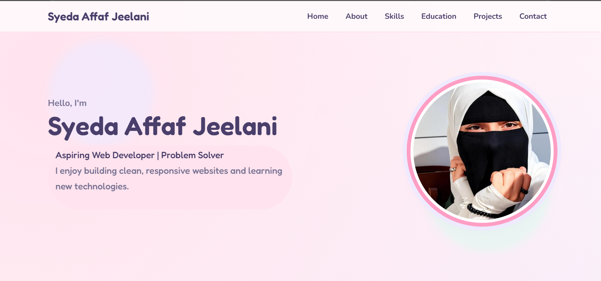
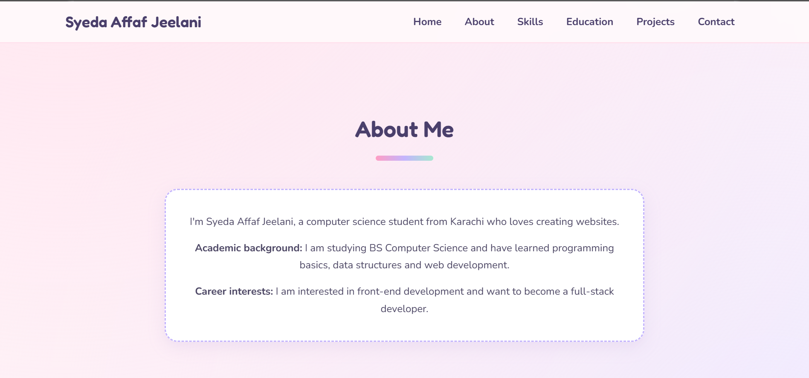
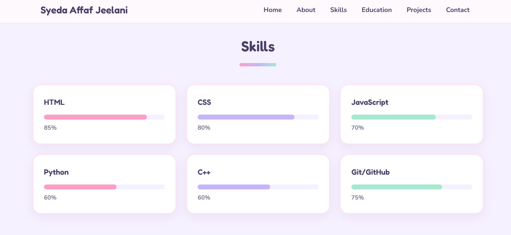
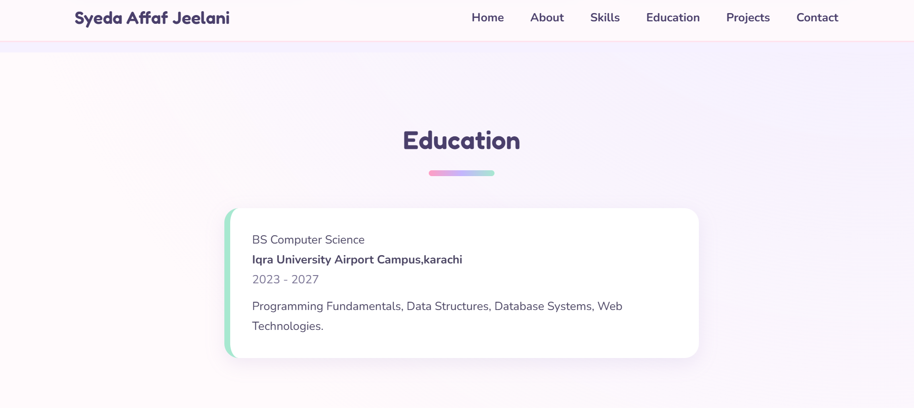
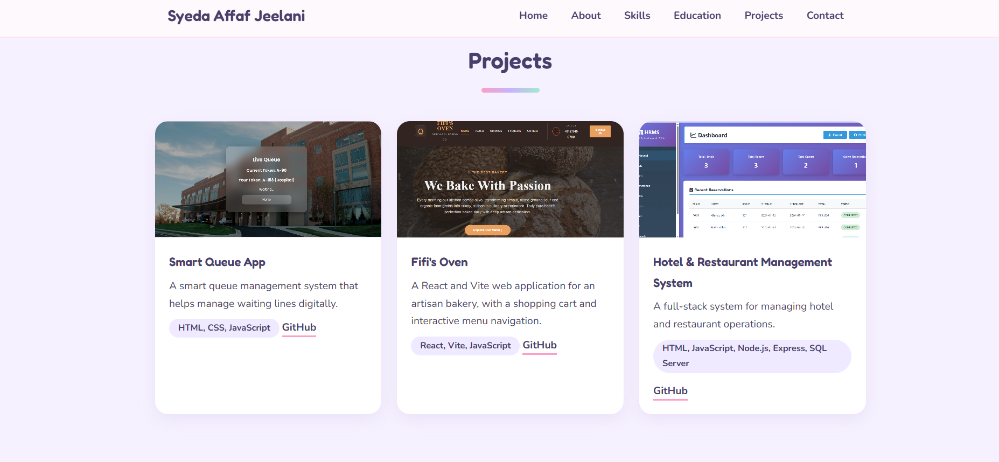
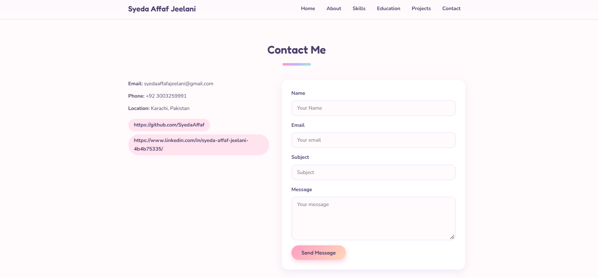

# Personal Portfolio Website

A modern, responsive personal portfolio website built with **HTML5** and **CSS3** only, created as **Task 01** of the Devixo Solutions Web Development Internship Program.

**Live demo:** [https://YOUR-USERNAME.github.io/YOUR-REPO-NAME/](https://YOUR-USERNAME.github.io/YOUR-REPO-NAME/)

## Project Description

This portfolio presents my profile, skills, education, projects, and contact details in a clean, pastel-themed interface. The whole site is written by hand in HTML and CSS, with no Bootstrap, Tailwind, UI frameworks, or downloaded templates.

## Technologies Used

- HTML5 (semantic markup)
- CSS3 (Flexbox, Grid, custom properties, media queries, transitions, keyframe animations)
- Google Fonts (Fredoka and Nunito)
- Git and GitHub

## Website Features

- Fixed navigation bar with smooth scrolling to every section
- Hamburger menu on tablet and mobile (pure CSS)
- Hero section with name, tagline, short introduction, profile image, and call-to-action button
- About section with a short introduction, academic background, and career interests
- Skills section with skill cards and animated progress bars
- Education section with degree, institute, study period, and academic details
- Projects section with at least three project cards (image, description, technologies, GitHub/demo link)
- Contact section with contact details, social links, and a contact form UI
- Footer with name, quick navigation links, social links, and copyright
- Hover animations on buttons, navigation links, skill cards, project cards, and social links
- Page-load animation in the hero and scroll-reveal animations for cards
- Fully responsive for desktop, laptop, tablet, and mobile with no horizontal scrolling
- Respects the "reduced motion" setting for accessibility

## Project Structure

```
portfolio/
├── index.html
├── style.css
├── README.md
├── images/
│   ├── profile.jpg
│   ├── project1.jpg
│   ├── project2.jpg
│   └── project3.jpg
└── screenshots/
    ├── home.png
    ├── about.png
    ├── skills.png
    ├── education.png
    ├── projects.png
    ├── contact.png
    ├── footer.png
    ├── desktop-view.png
    └── mobile-view.png
```

## Screenshots

### Desktop View


### Mobile View


### Home / Hero


### About


### Skills


### Education


### Projects


### Contact


### Footer


## How to Run the Website

1. Clone the repository:
   ```
   git clone https://github.com/https://https://github.com/SyedaAffaf/portfolio-website/YOUR-REPO-NAME.git
   ```
2. Open the project folder.
3. Double-click `index.html` to open it in your browser. No installation or build step is needed.

## Author

**YOUR NAME**
Web Development Intern, Devixo Solutions
GitHub: [@https://github.com/SyedaAffaf](https://github.com/https://github.com/SyedaAffaf)